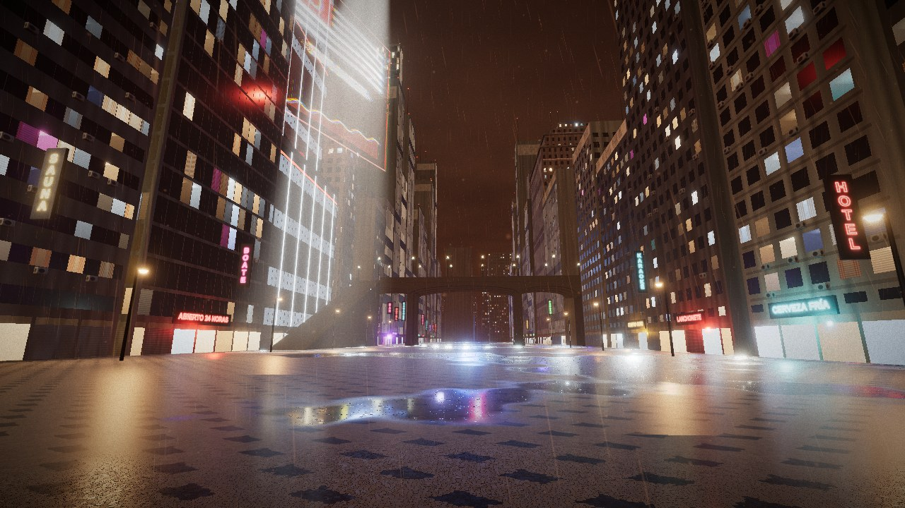

# GAROA · Vale do Anhangabaú, 2087

First-person graphics prototype of a cyberpunk São Paulo. Visual fidelity only: no game systems.



## Run

```bash
cd garoa
npm install
npm run dev        # http://127.0.0.1:5173
npm run build      # static build in dist/ (relative paths, deployable under any subfolder)
```

Click to lock the pointer. **WASD** move, **Shift** run, mouse look, **Q** cycle quality, **1 2 3** jump to the review viewpoints, **Esc** release.

The walkable area is the valley floor, the grand staircase on the west side, and the deck of the Viaduto do Chá.

## Quality

| preset | render scale | AA | SSR | volumetric steps | drizzle (streaks + mist) | neon point lights | spotlight shadows | dynamic resolution |
|---|---|---|---|---|---|---|---|---|
| low | 0.7 | none | off | 6 | 6k + 5k | 3 | off | on |
| medium (default) | 1.0 | SMAA | half res, 22 steps | 10 | 16k + 12k | 6 + hologram | off | on |
| high | min(DPR, 1.5) | 4x MSAA | half res, 40 steps | 16 | 32k + 24k | 8 + hologram | 1024 map | off |

Dynamic resolution trims the render scale (down to 60%) when frames run long and gives it back after a sustained run of on-time frames. Any preset key can be overridden from the URL for testing, for example `?q=medium&ssr=0&rainStreaks=0`.

## What is in the scene

- **Ridges**: one `InstancedMesh` holds every tower tier, about 3,500 instances including a far field to 1 km. A single extended `MeshStandardMaterial` builds each facade from per-instance data: five window styles, lit interiors with lightweight interior mapping (ceiling lamp, floor, walls, curtains, silhouettes), TV flicker, shopfronts and roller shutters, blind side walls, rain runoff, sodium street glow, wet roofs, and a distance fade so sub-pixel windows don't shimmer. Split AC condensers sit on the same window grid the shader uses; rooftops carry machine rooms, water tanks and masts.
- **Landmarks**: Edifício Martinelli (salmon, arched windows, cornices, stepped crown, palacete roof, MARTINELLI letters) on the east ridge; the Grupo Bandeira supertall (black glass, LED fins, red bands) on the west ridge with its holographic billboard.
- **Viaduto do Chá**: concrete deck with elliptical-soffit girders, paired piers, parapets, lamp posts, wet granite setts.
- **Calçada paulista**: Voronoi stones that each take the colour of the São Paulo state motif at their centre, so the outline is built from whole stones; basalt border, drain channels, puddles with raindrop ripples.
- **Signage**: Portuguese and Spanish neon (fascia, blade and rooftop signs) from one canvas atlas in one draw call, with flicker modes and coloured spill lights. Pixação in generated tag-reto alphabets on parapets, blind walls and the stair wall.
- **Sky and air**: helicopter on a patrol loop with a shadowed spotlight, synchronised aviation lights, a cloud deck lit from below.

## Rendering pipeline

`RenderPass` → `SSRPass` (custom) → fog `EffectPass` → drizzle pass → bloom + ACES + vignette + grain → SMAA (medium).

- **SSR** (`src/post/SSRPass.js`): detects up-facing surfaces from the depth buffer (no normal pass), takes normals from the same puddle and ripple model the floor uses (`src/shaders/wet.glsl.js`), traces at half resolution with geometric steps and binary refinement, then blurs mostly vertically for rain-slick streaks.
- **Fog** (`src/post/FogEffect.js`): closed-form exponential height fog in sodium orange, the searchlight beam as an analytic cone clip plus a short jittered march with Henyey-Greenstein forward scattering, and a backlit screen-space drizzle layer. It also scrubs NaN/Inf before bloom.
- **Lamp rows** (`src/shaders/lamps.glsl.js`): street lamps are regular rows, so the floor, deck and drizzle find their nearest lamps in O(1) and shade them through three's own `RE_Direct`, with a sphere-light lobe widening so mirror puddles cannot overflow the half-float buffer.
- **Drizzle** (`src/world/rain.js`): instanced streaks and mist animated in the vertex shader around the camera, lit by lamps and the searchlight, drawn after the fog with a manual depth test against the composer's depth texture.

## Review tooling

```bash
npm run dev &                                   # the scripts expect the dev server
node scripts/shoot.cjs shots/out high 60        # three fixed viewpoints, headless Playwright
CAMS=1 EXTRA="pos=6,1.7,40&look=2,0,30" node scripts/shoot.cjs shots/dbg high 60   # free camera
node scripts/bench.cjs                          # relative cost per preset and per feature
node scripts/test-walk.mjs                      # walk and collision checks (no browser)
node scripts/test-interact.cjs                  # walk, cycle quality, switch viewpoints live
```

`shots/02-city` through `shots/final` keep the screenshots from each iteration step.

## Performance: what was and was not measured

The development container has no GPU; headless Chromium renders with SwiftShader on the CPU. So **60 fps on a mid-range laptop has not been verified** and the frame times below are not GPU numbers. They are useful as ratios because SwiftShader's cost is dominated by fragment work.

| config, view 1, 1280x720 | SwiftShader ms/frame | vs medium |
|---|---|---|
| high | 3100 | 1.45x |
| medium | 2144 | 1.00 |
| low | 929 | 0.43 |
| medium, SSR off | 2070 | -3.5% |
| medium, drizzle off | 1862 | -13% (inflated: SwiftShader does vertex work on the CPU) |
| medium, neon point lights off | 2040 | -5% |
| high, MSAA off | 2687 | -13% |
| high, shadows off | 3038 | -2% |

Draw calls stay between 41 and 67 per frame. Most of the cost is base shading of the facades and the floor, not the effects. If a real GPU misses 60 fps on medium, the first levers are render scale (already automatic), the facade interior mapping, and the floor's per-pixel lamp loop.

## Credits

CC0 assets from [Poly Haven](https://polyhaven.com): *Shanghai Bund* HDRI by Greg Zaal (image-based reflections), *Concrete Wall 008* by Dario Barresi and Charlotte Baglioni (facades, viaduct, ridges), *Rusty Metal 02* by Rob Tuytel (sign cans, masts). Everything else is procedural.

The calçada motif follows Mirthes Bernardes' 1966 design in spirit; the outline here is a simplified approximation, not a survey of the original. Scene proportions are an artistic reading of the Anhangabaú, not measured.
